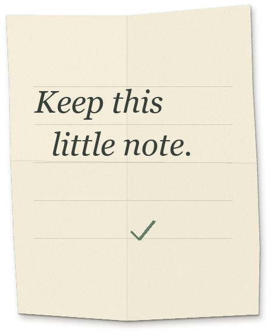

# Paper Note Digitizer

A Codex skill and a local Python utility for turning photographed paper notes into transparent assets. The output preserves the original outline and writing, with a fine edge and a short contact shadow.

- [Skill instructions and command examples](SKILL.md)
- [Synthetic source photo](example/synthetic-source.jpg) and [outline](example/outline.json)

